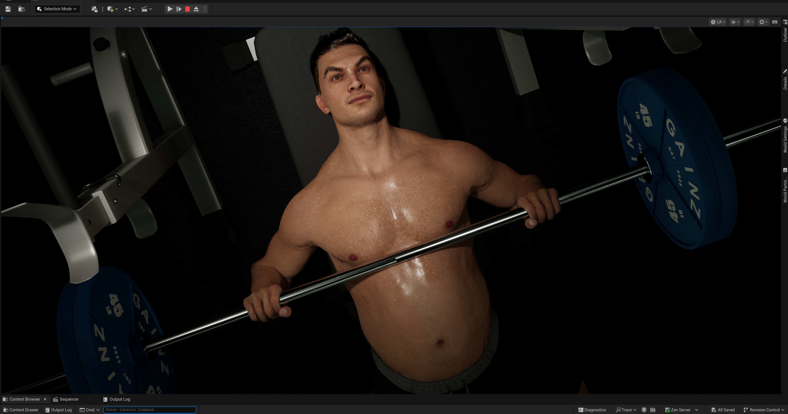

# MetaHuman Sweat

Sweat on MetaHuman skin for Unreal Engine: matte when dry, then a damp sheen, beads, and drops that run downhill.



*Beads, sheen and running drops on a MetaHuman during a bench press.*

https://github.com/user-attachments/assets/ea2d584b-f005-4b67-94a7-b6499608cbba

- **One component.** Add *MetaHuman Sweat* to the character and set its effort from gameplay, or let it follow the character's speed.
- **One menu command.** *Tools > MetaHuman Sweat > Add Sweat to Selected Actors* makes the sweat versions of the character's skin materials. Your original materials are not changed.
- **Stable drops.** Each drop starts at a fixed point on the skin and slides downhill on a clock, so animation cannot make the pattern swim.
- **No render targets.** The effect is a block of shader code in the skin material plus one mask texture per body part.

## Requirements

- Unreal Engine 5.8 or Unreal Engine 6. The same source builds on both.
- A C++ toolchain when you build from source (the UE 5.8 release package is prebuilt).
- Characters assembled by MetaHuman Creator in the engine (UE 5.6 or later), whose skin uses the `M_skin_unified_baked` master material. Older MetaHumans downloaded through Quixel Bridge use other skin materials and are not supported yet.

## Install

From source (UE 5.8 and UE 6):

1. Copy this folder to `<YourProject>/Plugins/MetaHumanSweat`.
2. Open the project and let it build the plugin (or build from your IDE).
3. *Edit > Plugins*: check that **MetaHuman Sweat** is enabled.

Prebuilt for UE 5.8 on Windows: download `MetaHumanSweat-1.0.0-UE5.8-Win64.zip` from the [Releases](../../releases) page and unzip it into `<YourProject>/Plugins`. It needs no compiler. There is no prebuilt package for UE 6: build it from source.

## Quick start

1. Put your MetaHuman in a level and select it.
2. Run **Tools > MetaHuman Sweat > Add Sweat to Selected Actors**. A report lists what was created under `/Game/MetaHumanSweat`. The actor now has a *MetaHuman Sweat* component.
3. Save the level, press Play and type in the console:

   ```
   mhs.SetSweat 0.7
   ```

4. Type `mhs.Dry` to dry the character again, or `mhs.Exert 1` to let sweat build up by itself.

To have the component on every copy of the character, add *MetaHuman Sweat* in its Blueprint instead of on the level actor.

## Driving it

| From | How |
|---|---|
| Blueprint or C++ | `Set Effort (0-1)`: sweat builds while effort is above 0 and dries by itself. `Set Sweat Level` jumps straight to a level. `Dry Now` resets. |
| The character's speed | Turn on **Effort From Speed** on the component and set **Full Effort Speed** (500 cm/s is about a run). |
| Rain and water | `Set Rain Exposure (0-1)` and `Set Immersion (0-1)` feed a second level, *wetness*: a thin film with fine droplets. The plugin reads no weather system; call these from yours. |
| The console | `mhs.Exert <0-1>`, `mhs.SetSweat <0-1>`, `mhs.SetWetness <0-1>`, `mhs.Dry`, `mhs.Status`, `mhs.Debug 1`, `mhs.Enabled 0|1` |

The look (intensity, bead density and size, streak length) and the pace (how fast sweat builds and dries) are in **Project Settings > Plugins > MetaHuman Sweat**, and can be overridden per character on the component.

Full details, every setting with its range, and troubleshooting: [Docs/UserGuide.md](Docs/UserGuide.md).

## What to know before you use it

- A stock MetaHuman body has underwear painted into its skin texture, and sweat is drawn over it like over skin (see the picture). Turn *Show Top Underwear* off in MetaHuman Creator's Skin settings before you assemble the character, or dress it.
- The sweat skin material costs about 490 more pixel-shader instructions than the dry one and one more texture sample. The component only swaps materials on the characters it is on, so put it on the characters that are seen up close.
- Sweat does not respond to temperature, humidity or the time of day by itself. Drive `Set Effort` from whatever your game knows.
- Trails are cut at the seams of the skin's UV layout, and drops do not drip off the body.
- In a packaged game the sweat materials must be cooked. The menu command adds `/Game/MetaHumanSweat` to *Additional Asset Directories to Cook* for you. Packaged builds have not been tested.

## Tested

| Engine | Built | Material tool | In-game check |
|---|---|---|---|
| Unreal Engine 6 | yes | yes | yes |
| Unreal Engine 5.8 | yes | yes | yes |

Tested with one average-build male MetaHuman on each engine, assembled with the default (optimized, high quality) pipeline. Other body types use the same UV layout, so the masks should fit, but they have not been checked.

## Licence

MIT. See [LICENSE](LICENSE).
